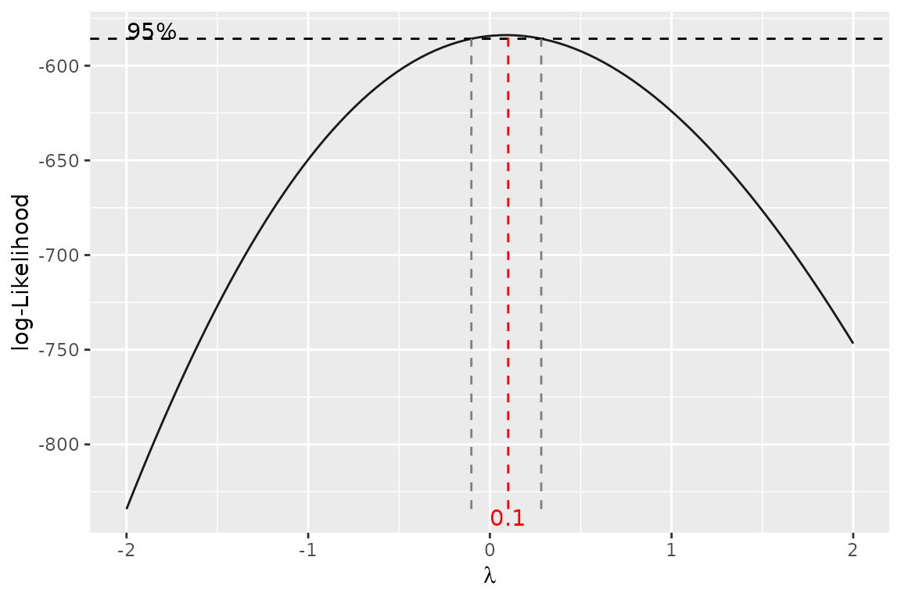
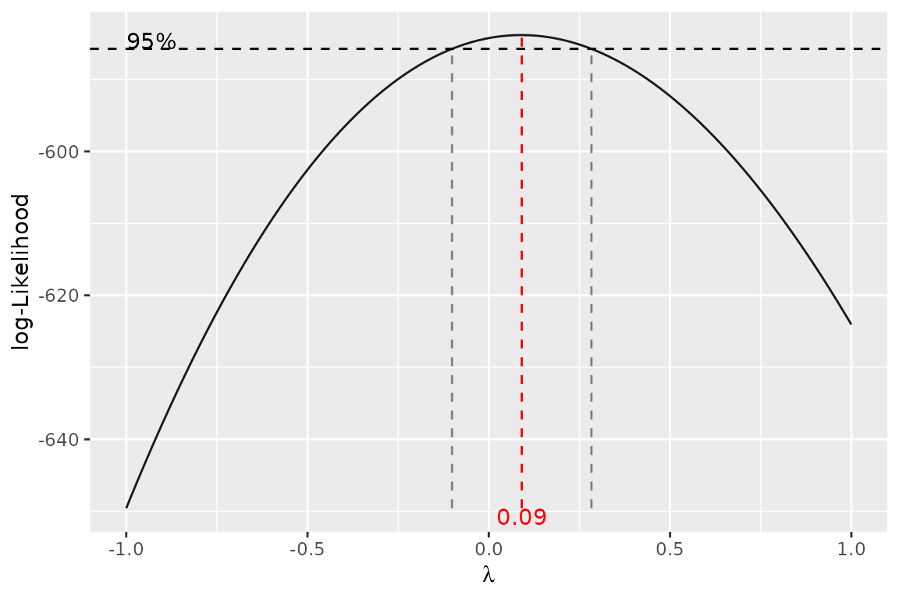

# Regression models

This vignette shows the functions for summarising and checking
regression models:

| Function | What it does |
|----|----|
| [`logist_summary()`](https://tranhung93.github.io/306/reference/logist_summary.md) | odds ratios, 95% CIs and p-values of a logistic regression |
| [`subgroup_effect()`](https://tranhung93.github.io/306/reference/subgroup_effect.md) | odds ratios of covariables within each level of an interacting factor |
| [`t()`](https://rdrr.io/r/base/t.html) | transposes a [`subgroup_effect()`](https://tranhung93.github.io/306/reference/subgroup_effect.md) result |
| [`as_sstable()`](https://tranhung93.github.io/306/reference/as_sstable.md) | turns these summaries (or a list of table parts) into an sstable |
| [`explicit()`](https://tranhung93.github.io/306/reference/explicit.md) | rewrites a linear model formula with every term spelled out |
| [`gg_boxcox()`](https://tranhung93.github.io/306/reference/gg_boxcox.md) | Box-Cox profile likelihood plot for a linear model, with `ggplot2` |

``` r

library(C306)
```

The examples use `baseline_data`, a **simulated** two-arm trial bundled
with the package, so the estimates illustrate the functions and say
nothing about the treatment. We model death (`outcome == 4`):

``` r

dat <- baseline_data
dat$Arm <- factor(dat$Arm, levels = c("Sham procedure", "Intrathecal treatment"))
dat$sex <- factor(dat$sex, levels = c("F", "M"), labels = c("Female", "Male"))
dat$died <- dat$outcome == 4
```

## Logistic regression: `logist_summary()`

[`logist_summary()`](https://tranhung93.github.io/306/reference/logist_summary.md)
takes a fitted binomial `glm` and returns one row per coefficient with
the log odds ratio, odds ratio, 95% CI and p-value.

``` r

fit <- glm(died ~ Arm + age + sex + apacheii, data = dat, family = binomial)
logist_summary(fit)
#> - Method: Likelihood ratio 
#> - CIs are calculated at 95% level of confidence.
#> 
#>                          log.OR   OR lower.CI upper.CI p.value
#> (Intercept)               -1.62 0.20     0.03     1.24  0.0840
#> ArmIntrathecal treatment   0.11 1.11     0.45     2.79  0.8154
#> age                       -0.01 0.99     0.96     1.03  0.7106
#> sexMale                   -1.05 0.35     0.14     0.94  0.0384
#> apacheii                   0.02 1.02     0.90     1.16  0.7163
```

The default `method = "lik.ratio"` gives profile-likelihood CIs and
likelihood-ratio tests, which behave better than Wald statistics in
small samples or with rare events. `method = "wald"` gives the Wald
versions:

``` r

logist_summary(fit, method = "wald")
#> - Method: Wald 
#> - CIs are calculated at 95% level of confidence.
#> 
#>                          log.OR   OR lower.CI upper.CI p.value
#> (Intercept)               -1.62 0.20     0.03     1.30  0.0910
#> ArmIntrathecal treatment   0.11 1.11     0.45     2.74  0.8155
#> age                       -0.01 0.99     0.96     1.03  0.7105
#> sexMale                   -1.05 0.35     0.14     0.91  0.0309
#> apacheii                   0.02 1.02     0.90     1.17  0.7155
```

`stat_digits` and `p_digits` set the decimal places. `verbose = TRUE`
prints a note on the method, and `flextable = TRUE` returns a
report-ready table:

``` r

logist_summary(fit, flextable = TRUE)
```

|  | log.OR | OR | lower.CI | upper.CI | p.value |
|----|----|----|----|----|----|
| (Intercept) | -1.62 | 0.20 | 0.03 | 1.24 | 0.0840 |
| ArmIntrathecal treatment | 0.11 | 1.11 | 0.45 | 2.79 | 0.8154 |
| age | -0.01 | 0.99 | 0.96 | 1.03 | 0.7106 |
| sexMale | -1.05 | 0.35 | 0.14 | 0.94 | 0.0384 |
| apacheii | 0.02 | 1.02 | 0.90 | 1.16 | 0.7163 |
| Note: 95% confidence intervals and p-values are based on likelihood ratio statistics. |  |  |  |  |  |

## Effects within subgroups: `subgroup_effect()`

When a covariable interacts with a factor, its odds ratio differs
between the levels of that factor.
[`subgroup_effect()`](https://tranhung93.github.io/306/reference/subgroup_effect.md)
computes the odds ratio, CI and p-value of each interacting covariable
within each level. The factor goes on the right-hand side of the
formula:

``` r

fit_ia <- glm(died ~ apacheii * Arm + age * Arm, data = dat, family = binomial)
subgroup_effect(~ Arm, fit_ia)
#> - Method: Likelihood ratio 
#> - CIs are calculated at 95% level of confidence.
#> 
#>  Arm = Sham procedure log.OR   OR CI.lower CI.upper p.value
#>              apacheii   0.02 1.02     0.84     1.21  0.8645
#>                   age   0.01 1.01     0.96     1.06  0.8223
#> 
#>  Arm = Intrathecal treatment log.OR   OR CI.lower CI.upper p.value
#>                     apacheii   0.01 1.01     0.85     1.19  0.9029
#>                          age  -0.02 0.98     0.94     1.03  0.4312
```

Put one covariable on the left-hand side to get a single table with one
row per level:

``` r

subgroup_effect(apacheii ~ Arm, fit_ia, method = "wald")
#> - Method: Wald 
#> - CIs are calculated at 95% level of confidence.
#> 
#>                       log.OR   OR CI.lower CI.upper p.value
#> Sham procedure          0.02 1.02     0.85     1.22  0.8641
#> Intrathecal treatment   0.01 1.01     0.85     1.20  0.9028
```

[`t()`](https://rdrr.io/r/base/t.html) regroups the result by covariable
instead of by level (the same as `transpose = TRUE`):

``` r

t(subgroup_effect(~ Arm, fit_ia, method = "wald"))
#> - Method: Wald 
#> - CIs are calculated at 95% level of confidence.
#> 
#>               apacheii log.OR   OR CI.lower CI.upper p.value
#>         Sham procedure   0.02 1.02     0.85     1.22  0.8641
#>  Intrathecal treatment   0.01 1.01     0.85     1.20  0.9028
#> 
#>                    age log.OR   OR CI.lower CI.upper p.value
#>         Sham procedure   0.01 1.01     0.96     1.05  0.8228
#>  Intrathecal treatment  -0.02 0.98     0.94     1.03  0.4341
```

The model can also be given as a formula, which is then fitted with
`glm(family = binomial)`:

``` r

subgroup_effect(age ~ Arm, died ~ age * Arm, data = dat, flextable = TRUE)
#> - Method: Likelihood ratio 
#> - CIs are calculated at 95% level of confidence.
#> 
#>                       log.OR   OR CI.lower CI.upper p.value
#> Sham procedure          0.01 1.01     0.96     1.06  0.8218
#> Intrathecal treatment  -0.02 0.98     0.94     1.03  0.4354
```

## Converting to sstable: `as_sstable()`

[`as_sstable()`](https://tranhung93.github.io/306/reference/as_sstable.md)
converts the result of
[`logist_summary()`](https://tranhung93.github.io/306/reference/logist_summary.md)
or
[`subgroup_effect()`](https://tranhung93.github.io/306/reference/subgroup_effect.md)
into an sstable (a list with `table` and `footer`), which the table
functions in
[`vignette("custom-tables", package = "C306")`](https://tranhung93.github.io/306/articles/custom-tables.md)
can format or combine with other tables:

``` r

ss <- as_sstable(logist_summary(fit))
ss$table
#>          ──────────────────────────────────────────────────────────────
#>                         log.OR   OR     lower.CI   upper.CI   p.value  
#>            (Intercept   -1.62    0.20   0.03       1.24       0.0840   
#>            )                                                           
#>            ArmIntrath   0.11     1.11   0.45       2.79       0.8154   
#>            ecal                                                        
#>            treatment                                                   
#>            age          -0.01    0.99   0.96       1.03       0.7106   
#>            sexMale      -1.05    0.35   0.14       0.94       0.0384   
#>            apacheii     0.02     1.02   0.90       1.16       0.7163   
#>          ──────────────────────────────────────────────────────────────
#> 
#> Column names: V1, V2, V3, V4, V5, V6
```

It also assembles a table from parts: a list with `header`, `body` (a
named list of matrices, one per row group) and an optional `footer`.

``` r

parts <- list(
  header = list(c("", "Sham procedure", "Intrathecal treatment")),
  body = list(
    "Age, years" = rbind(c("Mean", "50.1", "49.8"),
                         c("Median", "51", "49"))
  ),
  footer = "Illustrative numbers."
)
as_sstable(parts, flextable = TRUE)
```

|                       | Sham procedure | Intrathecal treatment |
|-----------------------|----------------|-----------------------|
| Age, years            |                |                       |
| Mean                  | 50.1           | 49.8                  |
| Median                | 51             | 49                    |
| Illustrative numbers. |                |                       |

## Explicit model formulas: `explicit()`

In a model with an interaction such as `bmi ~ age * sex`,
[`drop1()`](https://rdrr.io/r/stats/add1.html) only considers dropping
the interaction, because the main effects are implied by it.
[`explicit()`](https://tranhung93.github.io/306/reference/explicit.md)
refits the model with every term written out, so each main effect can be
tested or dropped on its own. The fit itself is unchanged.

``` r

fit_lm <- lm(bmi ~ age * sex, data = dat)
fit_explicit <- explicit(fit_lm)
formula(fit_explicit)
#> bmi ~ age + sexMale + `age:sexMale`
drop1(fit_explicit)
#> Single term deletions
#> 
#> Model:
#> bmi ~ age + sexMale + `age:sexMale`
#>               Df Sum of Sq    RSS    AIC
#> <none>                     3536.2 704.11
#> age            1    0.3320 3536.5 702.14
#> sexMale        1   18.3997 3554.6 703.52
#> `age:sexMale`  1    0.0335 3536.2 702.12
```

## Box-Cox plot: `gg_boxcox()`

[`gg_boxcox()`](https://tranhung93.github.io/306/reference/gg_boxcox.md)
is a `ggplot2` version of
[`MASS::boxcox()`](https://rdrr.io/pkg/MASS/man/boxcox.html). It plots
the profile log-likelihood of the Box-Cox power `lambda` for a linear
model with a positive response, with the 95% confidence interval for
`lambda` marked. A `lambda` near 0 suggests a log transformation, near 1
no transformation.

``` r

gg_boxcox(icudays ~ Arm + age, data = dat)
```



A fitted `lm` works too, and `lambda` sets the grid:

``` r

gg_boxcox(lm(icudays ~ Arm + age, data = dat), lambda = seq(-1, 1, 0.05))
```


