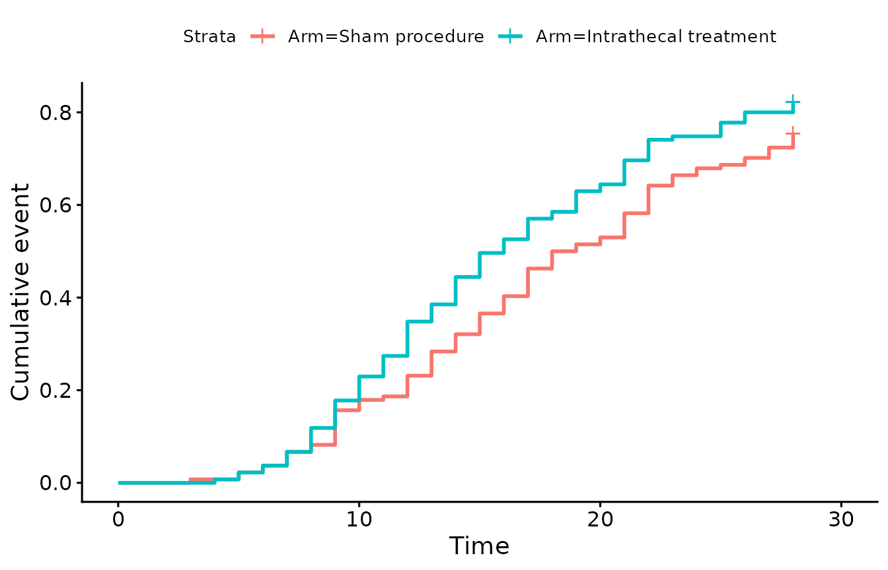
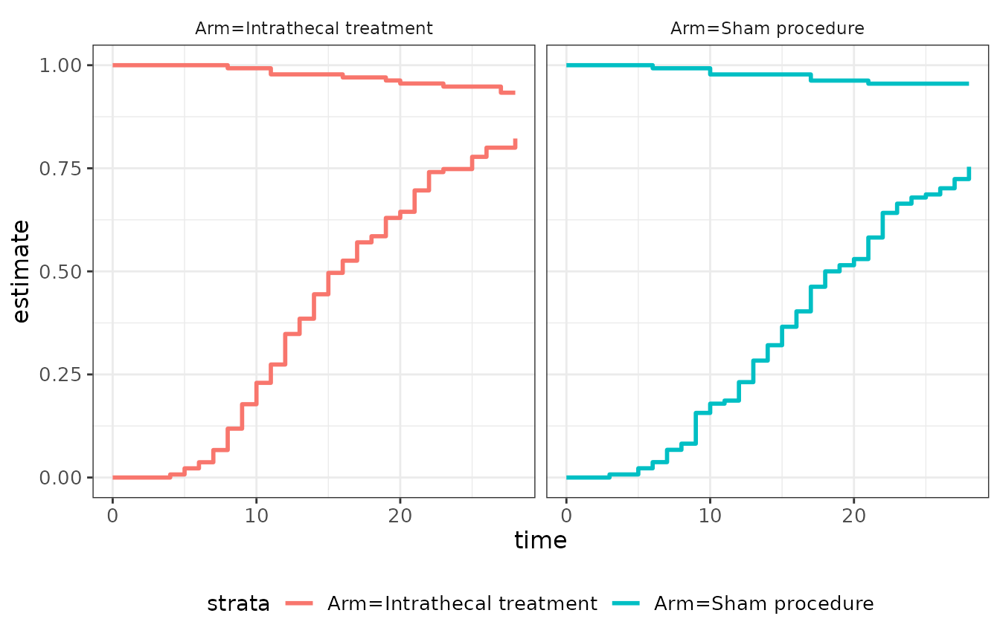
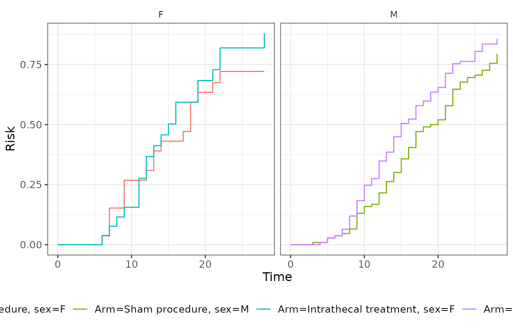

# Time-to-event outcomes

This vignette shows the functions for summarising and plotting
time-to-event outcomes in a two-arm trial:

| Function | What it does |
|----|----|
| [`sstable.survcomp()`](https://tranhung93.github.io/306/reference/sstable.survcomp.md) | events, risk, median time and the arm comparison (Cox, Fine-Gray, RMST or cumulative incidence) |
| [`sstable.survcomp.subgroup()`](https://tranhung93.github.io/306/reference/sstable.survcomp.subgroup.md) | the same comparison within subgroups, with a heterogeneity test |
| [`rbind()`](https://rdrr.io/r/base/cbind.html) | stacks two comparison tables (e.g. two populations) |
| [`gg_ajsurvplot()`](https://tranhung93.github.io/306/reference/gg_ajsurvplot.md), [`gg_ajsurvplot2()`](https://tranhung93.github.io/306/reference/gg_ajsurvplot2.md) | Aalen-Johansen cumulative incidence curves for competing risks |
| [`ggsurvfit2()`](https://tranhung93.github.io/306/reference/ggsurvfit2.md), [`tidy_survfit2()`](https://tranhung93.github.io/306/reference/tidy_survfit2.md) | Kaplan-Meier curves and tidy data that keep each stratifying variable as a column |

``` r

library(C306)
library(survival)
```

## Example data

The package ships `baseline_data`, a **simulated** two-arm trial in
tetanus (271 participants). It has no follow-up times, so for
illustration we derive a time-to-event outcome from the days spent in
the intensive care unit (`icudays`): each participant leaves the ICU
either alive (discharge) or by death (`outcome == 4`), and follow-up is
censored at day 28.

``` r

icu <- subset(baseline_data, !is.na(icudays))
icu$Arm <- factor(icu$Arm, levels = c("Sham procedure", "Intrathecal treatment"))
icu$time <- pmin(icu$icudays, 28)
icu$event <- factor(
  ifelse(icu$icudays > 28, "censor", ifelse(icu$outcome == 4, "death", "discharge")),
  levels = c("censor", "discharge", "death")
)
table(icu$Arm, icu$event)
#>                        
#>                         censor discharge death
#>   Sham procedure            27       101     6
#>   Intrathecal treatment     15       111     9
```

The first level of `event` is the censoring code, as
[`survival::Surv()`](https://rdrr.io/pkg/survival/man/Surv.html) expects
for competing-risks data. Because the data are simulated, the numbers
below illustrate the functions and say nothing about the treatment.

## Comparing two arms: `sstable.survcomp()`

The arm must be the first covariate on the right-hand side of the model.
With the default `compare.method = "cox"`, the table shows, for each
arm, the number of events out of the number of participants with the
event probability at the end of follow-up, the hazard ratio with its 95%
CI and p-value, a test for proportional hazards and the median (IQR)
time to event.

Here the event is discharge alive, and deaths are censored (a
cause-specific analysis):

``` r

sstable.survcomp(Surv(time, event == "discharge") ~ Arm, data = icu)
```

| Endpoint | Intrathecal treatment (n=135) | Sham procedure (n=134) | Comparison | Test for proportional hazards |
|----|----|----|----|----|
|  | events/n (risk \[%\]) | events/n (risk \[%\]) | HR (95%CI); p-value | p-value |
| event | 111/135 (85.97) | 101/134 (78.27) | 1.34 (1.02, 1.75); p=0.0346 | 0.621 |
| time |  |  |  |  |
| - Median (95%CI) | 15.00 (14.00, 18.00) | 18.00 (17.00, 21.00) |  |  |
| - Lower IQR (95%CI) | 11.00 (10.00, 12.00) | 13.00 (11.00, 15.00) |  |  |
| - Upper IQR (95%CI) | 22.00 (21.00, 26.00) | 27.00 (23.00, NA) |  |  |
| HR = hazard ratio; IQR = interquartile range. |  |  |  |  |
| HR and p value were based on Cox proportional hazards model. |  |  |  |  |

By default the output is a `flextable`. Use `flextable = FALSE` to get
the underlying character matrix and footer, which you can edit or
combine:

``` r

tab <- sstable.survcomp(Surv(time, event == "discharge") ~ Arm, data = icu,
                        flextable = FALSE)
tab$table
#>   ────────────────────────────────────────────────────────────────────────────
#>     Endpoint       Intrathecal    Sham           Comparison     Test for      
#>                    treatment      procedure                     proportional  
#>                    (n=135)        (n=134)                       hazards       
#>                    events/n       events/n       HR (95%CI);    p-value       
#>                    (risk [%])     (risk [%])     p-value                      
#>     event          111/135        101/134        1.34 (1.02,    0.621         
#>                    (85.97)        (78.27)        1.75);                       
#>                                                  p=0.0346                     
#>     time                                                                      
#>     - Median       15.00          18.00                                       
#>     (95%CI)        (14.00,        (17.00,                                     
#>                    18.00)         21.00)                                      
#>     - Lower IQR    11.00          13.00                                       
#>     (95%CI)        (10.00,        (11.00,                                     
#>                    12.00)         15.00)                                      
#>     - Upper IQR    22.00          27.00                                       
#>     (95%CI)        (21.00,        (23.00, NA)                                 
#>                    26.00)                                                     
#>   ────────────────────────────────────────────────────────────────────────────
#> 
#> Column names: V1, V2, V3, V4, V5
tab$footer
#> [1] "HR = hazard ratio; IQR = interquartile range."               
#> [2] "HR and p value were based on Cox proportional hazards model."
```

Other covariates can be added after the arm; the comparison is then
adjusted for them:

``` r

sstable.survcomp(Surv(time, event == "discharge") ~ Arm + age + sex, data = icu)
```

| Endpoint | Intrathecal treatment (n=135) | Sham procedure (n=134) | Comparison | Test for proportional hazards |
|----|----|----|----|----|
|  | events/n (risk \[%\]) | events/n (risk \[%\]) | HR (95%CI); p-value | p-value |
| event | 111/135 (85.97) | 101/134 (78.27) | 1.34 (1.02, 1.76); p=0.0331 | 0.634 |
| time |  |  |  |  |
| - Median (95%CI) | 15.00 (14.00, 18.00) | 18.00 (17.00, 21.00) |  |  |
| - Lower IQR (95%CI) | 11.00 (10.00, 12.00) | 13.00 (11.00, 15.00) |  |  |
| - Upper IQR (95%CI) | 22.00 (21.00, 26.00) | 27.00 (23.00, NA) |  |  |
| HR = hazard ratio; IQR = interquartile range. |  |  |  |  |
| HR and p value were based on Cox proportional hazards model. |  |  |  |  |

### Restricted mean survival time

`compare.method = "rmst"` compares the restricted mean time to event up
to `time` instead of the hazard. Here it is the mean number of days in
the ICU, restricted to the first 28 days:

``` r

sstable.survcomp(Surv(time, event != "censor") ~ Arm, data = icu, time = 28,
                 compare.method = "rmst")
```

| Endpoint | Intrathecal treatment (n=135) | Sham procedure (n=134) | Comparison |
|----|----|----|----|
|  | events/n (risk \[%\]) | events/n (risk \[%\]) | RMST difference (95%CI); p-value |
| event | 120/135 (88.89) | 107/134 (79.85) | -1.85 (-3.58, -0.13); p=0.0353 |
| time |  |  |  |
| - Median (95%CI) | 15.00 (14.00, 17.00) | 17.50 (16.00, 21.00) |  |
| - Lower IQR (95%CI) | 11.00 (10.00, 12.00) | 12.00 (10.00, 14.00) |  |
| - Upper IQR (95%CI) | 22.00 (20.00, 25.00) | 27.00 (22.00, NA) |  |
| RMST: Restricted mean survival time; IQR = interquartile range. |  |  |  |
| RMST difference and p value were based on Restricted mean survival time model. |  |  |  |

`compare.args = list(type = "ratio")` gives a ratio instead of a
difference. `compare.method = "cuminc"` compares the cumulative
incidence at `time` in the same way.

### Competing risks

When the left-hand side has a factor event,
[`sstable.survcomp()`](https://tranhung93.github.io/306/reference/sstable.survcomp.md)
fits a Fine-Gray model for the cause named in `compare.args` and reports
the Aalen-Johansen cumulative incidence. Here death competes with
discharge:

``` r

sstable.survcomp(Surv(time, event) ~ Arm, data = icu,
                 compare.args = list(cause = "discharge"))
```

| Endpoint | Intrathecal treatment (n=135) | Sham procedure (n=134) | Comparison | Test for proportional hazards |
|----|----|----|----|----|
|  | events/n (risk \[%\]) | events/n (risk \[%\]) | HR (95%CI); p-value | p-value |
| event | 111/135 (82.22) | 101/134 (75.37) | 1.30 (0.99, 1.71); p=0.0547 | 0.452 |
| HR = hazard ratio; IQR = interquartile range. |  |  |  |  |
| HR and p value were based on Fine-Gray model. |  |  |  |  |

## Subgroups: `sstable.survcomp.subgroup()`

Give the base model and a one-sided formula with the subgroup variable.
The table shows the comparison overall and within each subgroup, with a
test for the arm-by-subgroup interaction:

``` r

icu$ablett <- factor(icu$ablettscore, levels = c("I", "II", "III"),
                     labels = c("Ablett I", "Ablett II", "Ablett III"))
sstable.survcomp.subgroup(Surv(time, event == "discharge") ~ Arm, ~ ablett,
                          data = icu)
```

| Subgroup | Intrathecal treatment (n=135) | Sham procedure (n=134) | Comparison | Test for proportional hazards | Test for heterogeneity |
|----|----|----|----|----|----|
|  | events/n (risk \[%\]) | events/n (risk \[%\]) | HR (95%CI); p-value | p-value | p-value |
| All patients | 111/135 (85.97) | 101/134 (78.27) | 1.34 (1.02, 1.75); p=0.0346 | 0.621 |  |
| ablett |  |  |  |  | 0.614 |
| - Ablett I | 38/50 (82.28) | 41/52 (79.70) | 1.21 (0.77, 1.87); p=0.408 | 0.119 |  |
| - Ablett II | 48/59 (82.80) | 41/55 (76.78) | 1.28 (0.85, 1.95); p=0.24 | 0.98 |  |
| - Ablett III | 25/26 (100.00) | 19/27 (78.30) | 1.97 (1.07, 3.66); p=0.0306 | 0.117 |  |
| HR = hazard ratio |  |  |  |  |  |
| HR and p value were based on Cox proportional hazards model. |  |  |  |  |  |
| Test for heterogeneity is an Likelihood-ratio test for interaction between treatment effect and each subgroup in the survival model not including other variables. |  |  |  |  |  |

It accepts the same `compare.method` and `compare.args` as
[`sstable.survcomp()`](https://tranhung93.github.io/306/reference/sstable.survcomp.md).

## Stacking tables: `rbind()`

Tables made with `flextable = FALSE` can be stacked, for example to show
the whole population and a sub-population in one table. The header of
the first table is kept:

``` r

all_pts <- sstable.survcomp(Surv(time, event == "discharge") ~ Arm, data = icu,
                            medsum = FALSE, flextable = FALSE)
no_vaso <- sstable.survcomp(Surv(time, event == "discharge") ~ Arm,
                            data = subset(icu, vaso == "N"),
                            medsum = FALSE, flextable = FALSE)
both <- rbind(all_pts, no_vaso)
ss_flextable(both)
```

| Endpoint | Intrathecal treatment (n=135) | Sham procedure (n=134) | Comparison | Test for proportional hazards |
|----|----|----|----|----|
|  | events/n (risk \[%\]) | events/n (risk \[%\]) | HR (95%CI); p-value | p-value |
| event | 111/135 (85.97) | 101/134 (78.27) | 1.34 (1.02, 1.75); p=0.0346 | 0.621 |
| HR = hazard ratio; IQR = interquartile range. |  |  |  |  |
| HR and p value were based on Cox proportional hazards model. |  |  |  |  |

## Cumulative incidence curves

[`gg_ajsurvplot()`](https://tranhung93.github.io/306/reference/gg_ajsurvplot.md)
takes the same formula as
[`survival::survfit()`](https://rdrr.io/pkg/survival/man/survfit.html)
and draws the Aalen-Johansen cumulative incidence of one event type
(`etype`):

``` r

gg_ajsurvplot(Surv(time, event) ~ Arm, data = icu, etype = "discharge",
              fun = "event")
```



[`gg_ajsurvplot2()`](https://tranhung93.github.io/306/reference/gg_ajsurvplot2.md)
draws the main event and the competing event together, one panel per arm
by default (`facet.by = ~ strata`):

``` r

gg_ajsurvplot2(Surv(time, event) ~ Arm, data = icu,
               main.event = "discharge", competing.event = "death")
```



Both return `ggplot` objects, so they can be modified with the usual
`ggplot2` functions.

## Kaplan-Meier curves with several strata

[`ggsurvfit::ggsurvfit()`](http://www.danieldsjoberg.com/ggsurvfit/reference/ggsurvfit.md)
merges all stratifying variables into one `strata` column.
[`ggsurvfit2()`](https://tranhung93.github.io/306/reference/ggsurvfit2.md)
keeps each variable as its own column, so you can facet by one variable
and colour by another:

``` r

fit <- survfit(Surv(time, event == "discharge") ~ Arm + sex, data = icu)
ggsurvfit2(fit, type = "risk") + ggplot2::facet_wrap(~ sex)
```



[`tidy_survfit2()`](https://tranhung93.github.io/306/reference/tidy_survfit2.md)
returns the same data as a data frame, one column per stratifying
variable:

``` r

head(tidy_survfit2(fit, times = c(7, 14, 21, 28)))
#> # A tibble: 6 × 18
#>    time n.risk n.event n.censor cum.event cum.censor estimate std.error
#>   <dbl>  <dbl>   <dbl>    <dbl>     <dbl>      <dbl>    <dbl>     <dbl>
#> 1     7     25       2        0         2          0    0.923    0.0566
#> 2    14     13       9        3        11          3    0.543    0.190 
#> 3    21      7       6        0        17          3    0.271    0.345 
#> 4    28      3       3        3        20          6    0.121    0.608 
#> 5     7    105       7        0         7          0    0.936    0.0251
#> 6    14     67      42        0        49          0    0.550    0.0866
#> # ℹ 10 more variables: conf.high <dbl>, conf.low <dbl>, strata <fct>,
#> #   estimate_type <chr>, estimate_type_label <chr>, monotonicity_type <chr>,
#> #   strata_label <chr>, conf.level <dbl>, Arm <chr>, sex <chr>
```
